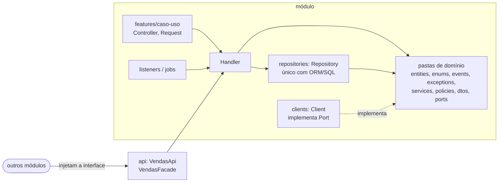
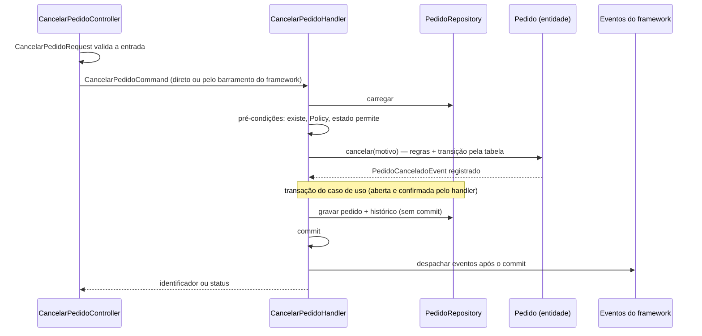

# Arquitetura

> Estado atual da arquitetura de {{AGENTE: NOME_DO_PROJETO}}. O histórico das decisões está em [docs/adr/](docs/adr/). Diagramas seguem o [modelo C4](https://c4model.com/).

## 1. Objetivos e atributos de qualidade

O que a arquitetura precisa garantir, em ordem de prioridade. Quando dois atributos entrarem em conflito, o de cima vence.

| # | Atributo | Meta mensurável | Táticas principais |
|---|---|---|---|
| 1 | Manutenibilidade | {{USUARIO: ex.: mudança típica toca 1 módulo}} | módulos com fronteiras claras, regra de dependência checada no CI |
| 2 | Modificabilidade segura por agentes | {{USUARIO: ex.: 100% dos PRs passam pela verificação completa no CI}} | testes rápidos, docs como fonte de verdade, limites explícitos em AGENTS.md |
| 3 | Disponibilidade | {{USUARIO: ex.: 99,9% mensal}} | timeouts, retries com backoff, circuit breaker, degradação elegante |
| 4 | Segurança e privacidade | {{USUARIO: ex.: zero vazamento entre tenants}} | validação nas bordas, menor privilégio, autorização por `Policy` em todo caso de uso |
| 5 | Desempenho | {{USUARIO: ex.: p95 < 300 ms}} | cache, consultas otimizadas no lado de leitura |

Restrições: {{USUARIO: ex.: dados devem ficar na região X; equipe de N pessoas; orçamento de infraestrutura}}.

## 2. Contexto do sistema (C4 nível 1)

```mermaid
flowchart LR
  user([Usuário]) --> app[{{AGENTE: NOME_DO_PROJETO}}]
  admin([Operador / admin]) --> app
  app --> idp[(Provedor de identidade<br/>{{USUARIO: IDP}})]
  app --> ext[(Sistemas externos<br/>{{AGENTE: SISTEMAS_EXTERNOS}})]
```

## 3. Contêineres (C4 nível 2)

```mermaid
flowchart TB
  web[Frontend<br/>{{AGENTE: FRONTEND}}] -->|HTTPS| api[Aplicação<br/>monolito modular]
  api --> db[(Banco relacional<br/>{{AGENTE: BANCO_DE_DADOS}})]
  api --> cache[(Cache<br/>{{AGENTE: CACHE}})]
  api -->|filas e eventos do framework| bus[[Fila / mensageria<br/>{{AGENTE: MENSAGERIA}}]]
  bus --> worker[Workers<br/>consumidores e jobs]
  worker --> db
```

| Contêiner | Responsabilidade | Tecnologia |
|---|---|---|
| Frontend | interface; módulos e fatias espelham os do backend ([docs/FRONTEND.md](docs/FRONTEND.md)) | {{AGENTE: FRONTEND}} |
| Aplicação | API, casos de uso, regras de domínio | {{AGENTE: FRAMEWORK}} |
| Workers | worker de fila do framework: listeners assíncronos e jobs | mesmo código-fonte, outro processo |
| Banco relacional | estado transacional, um schema por módulo (e a fila, se o driver for o banco) | {{AGENTE: BANCO_DE_DADOS}} |
| Fila / mensageria | jobs e listeners assíncronos, eventos de integração | {{AGENTE: MENSAGERIA}} |

## 4. Estilo arquitetural

**Monolito modular com fatias verticais e domínio rico** ([ADR-0002](docs/adr/0002-monolito-modular-com-fatias-verticais.md)), construído **framework first** ([ADR-0005](docs/adr/0005-framework-first.md)) e com **separação de responsabilidades estrita** (seção 4.1). Um único deploy, dividido em módulos alinhados aos *bounded contexts* do [domínio](docs/DOMAIN.md). Ganhamos a simplicidade operacional de um monolito e mantemos fronteiras que permitem extrair um módulo para um serviço quando houver motivo concreto: escala independente, time dedicado ou requisito de isolamento.

Fronteiras claras também são o que permite a agentes de código trabalhar bem: uma tarefa típica cabe dentro de um módulo, com contexto pequeno e testes locais.

O frontend usa **módulos espelhados**: os mesmos módulos e fatias do backend, com os mesmos nomes (`modules/vendas/features/criar-venda/` dos dois lados), de modo que uma tarefa seja uma fatia em cada lado. Estrutura e regras em [docs/FRONTEND.md](docs/FRONTEND.md).

Dentro de cada módulo, o código é organizado por **caso de uso** (fatias verticais em `features/`), apoiado por um **domínio rico** compartilhado entre as fatias. Uma tarefa típica corresponde a uma pasta de `features/` e, se houver regra nova, a um ou dois arquivos das pastas de domínio (`entities/`, `enums/`, `services/`, ...).

**Framework first.** Cada peça usa o recurso que {{AGENTE: FRAMEWORK}} documenta, do jeito que a documentação mostra; solução própria só quando o framework não oferece, com justificativa. A separação de responsabilidades define **onde** cada recurso é usado.

| Decisão | Neste projeto | Orientação |
|---|---|---|
| Entidade / agregado | {{AGENTE: ENTIDADE: model do ORM (active record) ou classe de domínio separada — seguir o idioma do framework}} | com active record, o model é a entidade: guarda regras, transições e a configuração declarativa do ORM, mas as chamadas de consulta e persistência ficam no repository; com classe separada, o repository usa um mapper para converter linha do ORM ↔ agregado |
| Comandos, consultas e eventos | {{AGENTE: MECANISMO_DE_COMANDOS_E_EVENTOS_DO_FRAMEWORK}} | se o framework tem barramento ou dispatcher, handlers e listeners são registrados nele; se não tem, o controller chama o handler direto |
| Filas e jobs | {{AGENTE: MECANISMO_DE_FILAS_DO_FRAMEWORK}} | listeners assíncronos e jobs pela fila do framework, delegando a handlers |
| Autorização | {{AGENTE: MECANISMO_DE_AUTORIZACAO_DO_FRAMEWORK}} | `Policy` no formato do framework |
| Feature flags | {{AGENTE: MECANISMO_DE_FEATURE_FLAGS}} | usado direto, sem interface própria |
| Cliente HTTP para sistemas externos | {{AGENTE: CLIENTE_HTTP_DO_FRAMEWORK}} | só dentro do `Client`; timeout e retry pelos recursos do cliente |
| Data/hora e IDs | recursos da linguagem, do framework ou do ORM ({{AGENTE: ex.: UUIDv7}}) | nos testes, congelar o tempo com o helper da ferramenta de testes |
| Erros HTTP | tratamento global de exceções do framework | exceções de domínio mapeadas para Problem Details num só lugar |

Onde o framework tem pastas convencionais para essas peças (ex.: `Models/`, `Policies/`, `Events/`, `Listeners/`), elas ficam dentro do módulo com os nomes do framework. `features/` continua sendo a pasta das fatias.

### 4.1 Responsabilidades

Cada artefato tem um único motivo para mudar (SRP). Esta matriz é a referência para escrever e revisar código.

| Artefato | Responsabilidade (faz) | Pode depender de | Não pode |
|---|---|---|---|
| Route | mapear URL/verbo → controller | controller | lógica |
| Request | validar a **forma** da entrada (presença, tipo, tamanho, formato estrutural) e autorização simples pelo mecanismo do framework (chamando a `Policy`); a regra que tem value object (`Cnpj`, `Email`) fica **só** no VO: o request não a repete, e a rejeição do VO vira 400 com `campo` pelo tratamento global de erros (erros de vários VOs, um por vez ou juntos: [CODING_GUIDELINES.md](CODING_GUIDELINES.md#2-modelagem-e-tipos)) | regras de validação do framework | repetir a validação de um VO, repository, ORM, consulta ao banco (inclusive regras de validação que consultam o banco, como "existe" ou "único": existência e unicidade são verificadas no handler via repository e garantidas por constraint), regra de negócio |
| Controller | adaptar HTTP: receber o Request, montar Command/Query, despachar (handler ou barramento), devolver Resource/resposta | Request, Command/Query, handler/barramento, Resource | repository, ORM, entidade com regra, regra de negócio, try/catch de regra (erros vão para o tratamento global do framework) |
| Command / Query | carregar a intenção (dados imutáveis) | tipos primitivos, enums, VOs | comportamento |
| Handler | ser o **roteiro do caso de uso**: lendo só ele, sabe-se o que é carregado, checado, mudado, gravado e o que acontece depois (forma fixa em [§5.1](#51-comando-escrita)); autorizar (`Policy`); delimitar a transação à vista; despachar reações após o commit | repository, entidade/VO/enum, domain service, policy, `Port`, mecanismo de eventos do framework | ORM direto, HTTP (request/response), regra de negócio (`if` de negócio), terceirizar a sequência para um service do agregado (passo comum a vários handlers vai para o domínio, para um método do repository com nome do conceito ou para uma reação a evento: [CODING_GUIDELINES.md](CODING_GUIDELINES.md#passo-comum-a-vários-casos-de-uso)), ler sessão, contexto ambiente ou objeto HTTP (as entradas estão no Command/Query) |
| Entity / Aggregate | regras de negócio como métodos de intenção e predicados com nome do negócio, invariantes, mudar de estado **só pela tabela de transições** ([§5.4](#54-estados-e-transições)), cálculos do próprio estado, registrar eventos | VO, enum, evento, exceção de domínio, outras entidades do mesmo agregado | persistir ou consultar (salvar, buscar, query), HTTP, sistema externo, `Port`, disparar efeito externo |
| Value object | conceito imutável com validação e comportamento (`Dinheiro`, `Cpf`) | outros VOs | I/O |
| Enum | conjunto fechado de estados, a **tabela de transições permitidas** (ação de negócio → origem → destino), conjuntos de estados com nome e comportamento associado (rótulo) | — | I/O |
| Domain service | regra que envolve vários agregados ou entidades, recebendo os dados prontos; inclui o *gate* (classe pura que avalia regras independentes e devolve a lista de falhas) | entidade, VO, enum | I/O, repository |
| Policy | regra de autorização (quem pode fazer o quê), no mecanismo do framework: método do agregado quando depende só do estado dele; classe instanciável e injetada quando depende do usuário e do agregado | entidade, usuário | consulta própria ao banco, regra de negócio do agregado, métodos estáticos |
| Event | fato ocorrido (dados imutáveis) | tipos, VOs | comportamento, ler request, sessão ou contexto ambiente |
| Listener / Subscriber | reagir a um fato, depois do commit, delegando a um handler/command | handler/barramento | regra de negócio, ORM direto, gravar ou mudar o agregado que disparou o evento (isso é passo do caso de uso) |
| Job | executar algo assíncrono delegando a um handler ou client | handler, client | regra de negócio, ORM direto |
| Comando de lote / CLI / agendamento | borda como o controller: ler argumentos, montar o command e chamar o handler (direto ou pelo barramento), entregar o resultado ao formatter da saída; ser idempotente; registrar o que processou. A formatação da saída (CSV, texto) é uma classe com teste (`RelatorioVendasCsvFormatter`), na fatia do caso de uso como o Resource do HTTP; usada por várias fatias, sobe para o módulo pela regra de "onde colocar" | handler/barramento, formatter | regra de negócio, ORM direto, formatar a saída em funções soltas no ponto de entrada, subir consumidores de fila ou a aplicação HTTP inteira só para rodar |
| Repository | persistir e recuperar agregados; consultas de leitura (DTOs, read models) com nome que revela todo filtro de negócio aplicado; **único lugar com ORM/SQL**; devolve dados e entidades, e a composição entre agregados é do handler ou do domínio; `obter*` lança a exceção "não encontrado" do módulo ([verbos com contrato de retorno](CODEBASE_MAP.md#verbos-com-contrato-de-retorno)) | ORM, model/entidade, enum, DTO, mapper, exceção "não encontrado" do módulo | **outro repository**; regra ou cálculo de domínio (o critério de um conceito vem do enum ou da specification, [CODING_GUIDELINES.md](CODING_GUIDELINES.md#um-conceito-em-memória-e-na-consulta)); service ou policy; HTTP, receber objeto HTTP ou ler o usuário do contexto, **abrir ou confirmar transação** (persiste e agenda; quem confirma é o caso de uso) |
| Port (interface) | contrato de sistema externo ou LLM | tipos do domínio | — |
| Client | implementar o `Port`; **único lugar com HTTP/SDK do sistema externo**; traduzir nomes, erros e protocolo externos para o vocabulário do domínio (anticorruption layer) | cliente HTTP do framework, SDK | regra de negócio |
| Resource / Presenter | formatar a saída | dados já carregados | disparar consultas (lazy loading), regra de negócio |
| Mapper | converter linha do ORM ↔ agregado; classe instanciável e injetada, usada só pelo repository (só quando a entidade é classe separada do model) | entidade, tipos do ORM | métodos estáticos |
| Api / Facade | API pública do módulo: a interface `<Modulo>Api` (métodos de negócio, só DTOs públicos) e a classe `<Modulo>Facade` que a implementa e **só delega** aos handlers do próprio módulo | handlers do módulo, DTOs públicos | regra de negócio, ORM, `repositories/`, `clients/`, expor entidade interna |
| Módulo / provider | ligar dependências e registrar rotas, eventos, policies | tudo do módulo | lógica |
| Migration / factory / seeder | schema / dados de teste / dados iniciais | ORM | regra de negócio |

**Sinais de violação** (para revisão e para agentes): controller com `if` de negócio; consulta do ORM ou SQL fora de repository; entidade chamando salvar ou buscar; handler com regra de negócio; request com consulta ao banco; listener ou job com lógica própria. E também:
- commit escondido num nome neutro (repository que confirma a transação; duas transações num caso de uso; transação aninhada);
- status mudado por fora da tabela de transições (atribuição direta, atualização em massa, gancho que troca o destino);
- gravação ou efeito do caso de uso como listener em outro arquivo, dependente da ordem de despacho;
- efeito externo (HTTP, e-mail, fila) dentro da transação ou disparado pela entidade;
- entrada por canal lateral (objeto HTTP no repository, sessão entre requisições, contexto ambiente);
- handler que só repassa para um service do agregado com todos os casos de uso;
- o mesmo sub-roteiro (travar, carregar, atualizar, salvar) ou a mesma montagem de entrada do domínio copiada em vários handlers, ou handler que passa da referência de ~25–30 linhas ([limite do papel](CODING_GUIDELINES.md#tamanho-e-complexidade-por-papel)) ou de ~5 dependências por causa dele;
- repository que injeta outro repository ou calcula uma regra de domínio;
- regra sem nome fora do dono (número mágico no handler, regra repetida em dois lugares);
- o mesmo conceito de negócio definido de mais de um jeito (ex.: "disponível" calculado num handler e numa consulta);
- erro engolido, convertido em resultado vazio ou seguido de commit;
- escrever antes de validar.

**Sinais de domínio anêmico:** handler chamando setters em sequência para mudar o estado; entidade ou model sem método de intenção (só getters e setters); `servico.fazerX(entidade)` com regra que pertence à própria entidade (deveria ser `entidade.fazerX()`).

**Controller e handler finos são deliberados.** Eles parecem só "passar adiante", mas cada um isola uma responsabilidade (HTTP de um lado, orquestração e transação do outro). Não funda camadas nem elimine essas bordas por parecerem rasas: o critério de "intermediário inútil" (*middle man*, módulo raso) não se aplica a elas. Vale para classes internas criadas sem motivo, não para os artefatos desta matriz.

**Cada salto entre arquivos traz informação nova.** O handler não terceiriza a sequência para um `XService` que concentra todos os casos de uso do agregado, e uma fachada não delega para outra sem lógica: isso acrescenta um arquivo ao caminho de leitura sem nada novo e faz o service crescer até misturar todos os casos de uso. A `<Modulo>Facade` também só delega, mas traz informação nova: marca a fronteira do módulo e é o único ponto que outro módulo conhece.

### 4.2 Pastas

O princípio vem antes da tabela, porque é ele que torna a localização dedutível:
- **Um nome de negócio em toda a cadeia.** O verbo do caso de uso se repete, igual e com o mesmo número gramatical, na rota, no Request, no Command, no Handler, na transição e no evento resultante (`cancelar` → `CancelarPedidoController` → `CancelarPedidoHandler` → transição `CANCELAR` → `PedidoCanceladoEvent`). Uma busca textual acha a cadeia inteira.
- **Mesmo gabarito em todo lugar.** Todo caso de uso tem os mesmos arquivos nos mesmos lugares; o prefixo diz o conceito e o sufixo, o papel.
- **Árvore rasa.** Nenhuma pasta de camada técnica dentro da fatia (`http/`, `dto/`, `core/`): cada nível a mais é mais uma árvore a abrir para a mesma tarefa.
- **Uma entrada por intenção.** Cada operação de negócio, inclusive cada transição de estado, é uma fatia própria; a lista de fatias é o catálogo do que o módulo faz.
- **Tudo o que roda está ligado à vista.** Todo caso de uso, reação e client é registrado no `<modulo>.module`; experimento, código morto e alternativa comentada saem da árvore.

**Variante aceita: pastas por tipo do framework com subcaminho espelhado.** Em bases que já seguem as pastas convencionais do framework (controllers, requests, ações em árvores separadas), cada caso de uso usa o mesmo subcaminho `Conceito/Verbo` em todas as árvores, com o mesmo número gramatical, e uma verificação automática confere o espelhamento ([§9](#9-fitness-functions)). A organização por conceito (casos de uso dentro da pasta do agregado) foi rejeitada ([ADR-0002](docs/adr/0002-monolito-modular-com-fatias-verticais.md)).



| Pasta | Contém |
|---|---|
| `features/<caso-uso>/` | uma fatia por caso de uso (inclusive uma por transição de estado): `Controller`, `Request`, `Command` ou `Query`, `Handler`, `Resource` opcional |
| `entities/` | agregado, entidades com regras (no formato definido acima) e value objects |
| `enums/` | `Enum` (inclusive o de estado, com a tabela de transições) |
| `events/` | `Event` |
| `exceptions/` | `Exception` de domínio |
| `services/` | serviço de domínio (`Service`) |
| `specifications/` | `Specification`: conceito composto com o predicado em memória (`satisfeitaPor`) e o critério da consulta no mesmo arquivo ([CODING_GUIDELINES.md](CODING_GUIDELINES.md#um-conceito-em-memória-e-na-consulta)) |
| `policies/` | `Policy` |
| `dtos/` | DTOs de leitura usados por repository e query (o DTO público fica em `api/`) |
| `ports/` | interfaces `Port` de fronteira externa (as únicas interfaces do domínio) |
| `repositories/` | `Repository` (classe concreta, sem interface; um por agregado, com métodos de escrita e de leitura; se as leituras crescerem, um `QueryRepository` separado, também concreto) |
| `mappers/` | `Mapper` registro do ORM ↔ entidade (só se a entidade for classe separada do model do ORM) |
| `clients/` | `Client` que implementa um `Port` (*anticorruption layer*) |
| `jobs/` | `Job`, que delega a handler |
| `listeners/` | reações a eventos, registradas no mecanismo do framework: `Listener` (evento do próprio módulo) e `Subscriber` (evento de outro módulo) |
| `api/` | API pública do módulo: interface `<Modulo>Api` (com token de injeção do mesmo nome, se o framework usar), DTOs públicos e `<Modulo>Facade` |
| `index` | exporta só o registro do módulo e o que está em `api/` |
| `<modulo>.module` | registro do módulo no framework (rotas, listeners, policies, bindings); liga cada `Port` (e a API pública) à sua implementação |

Uma pasta por tipo de arquivo: o sufixo do nome diz a pasta (`*Exception` → `exceptions/`). Os nomes estão em minúsculas; cada stack adapta a capitalização ao idioma de {{AGENTE: FRAMEWORK}}. **Pasta só existe quando há arquivo para ela**: módulo pequeno pode ter só `features/`, `entities/` e `repositories/`.

**Regras de dependência**, verificadas por `{{AGENTE: CMD_ARCH_CHECK}}` no CI (o que a ferramenta não distinguir fica para a revisão, guiada pela matriz):

1. Uma fatia não importa outra fatia. Código usado por duas fatias sobe para a pasta do seu tipo no módulo (`entities/`, `services/`, `repositories/`, ...).
2. Outros módulos só importam `api/` (e o registro do módulo), e injetam a interface `<Modulo>Api`, nunca a facade nem handlers.
3. ORM e SQL só em `repositories/*Repository`. Leituras também passam pelo repository.
4. Controller e Request não importam repository nem ORM.
5. Listeners e jobs não usam ORM; delegam a handlers.
6. Entidades não usam repository, client nem HTTP.
7. Sistema externo e LLM só via `Port`; HTTP e SDK de sistema externo só no `Client` de `clients/`.
8. As pastas de domínio (`entities/`, `enums/`, `events/`, `exceptions/`, `services/`, `specifications/`, `policies/`, `dtos/`, `ports/`) não importam `repositories/`, `mappers/`, `clients/`, `jobs/`, `features/` nem `listeners/`, nem o ORM, HTTP ou SDK. `repositories/`, `mappers/` e `clients/` não importam `features/` nem `listeners/` (jobs e listeners delegam a handlers). O domínio pode usar os recursos do framework que fazem parte do modelo idiomático (ex.: o model do ORM como entidade, quando o framework é active record, e decorators de eventos).
9. Interfaces só nos casos da [ADR-0004](docs/adr/0004-interfaces-so-em-fronteiras.md); nas pastas de domínio, só em `ports/` e com sufixo `Port`. Bindings só para `Port` e API pública; o resto é resolvido pelo container de injeção do framework. Resolução por convenção só quando a regra é única, total e está escrita; nada de despacho por string, método mágico ou troca de classe por varredura de pasta, que quebram "ir para a definição" e a busca textual.

## 5. Fluxos principais

### 5.1 Comando (escrita)

O handler é o roteiro do caso de uso e tem sempre a mesma forma, lida de cima para baixo. Depois de ler um caso de uso, o leitor conhece o roteiro de todos e só procura o que muda.

1. **Carregar** o que o caso de uso precisa, pelo repository.
2. **Pré-condições**, falhando cedo: existe, tem permissão (`Policy`), o estado atual permite.
3. **Domínio:** a entidade ou o serviço de domínio aplica as regras. Regras independentes sobre os dados são avaliadas todas e devolvidas juntas ([CODING_GUIDELINES.md](CODING_GUIDELINES.md#4-erros)).
4. **Transição** de estado, pela tabela ([§5.4](#54-estados-e-transições)).
5. **Gravar** num bloco curto, dentro da transação do caso de uso: o agregado e os registros que o negócio exige consistentes com ele (histórico, caixa de entrada, itens dependentes).
6. **Efeitos depois do commit:** despachar eventos; HTTP, e-mail e fila nunca dentro da transação.
7. **Responder** com identificador ou status.



**Transação.** O limite da transação está à vista no caso de uso, com o recurso de transação do framework ou do ORM. "O que é atômico?" se responde olhando um bloco; um commit escondido num método de nome neutro faz duas gravações parecerem um par atômico sem ser.
- **Uma transação por caso de uso.** Dentro do módulo, ela pode incluir os registros que o negócio exige consistentes (histórico, caixa de entrada, itens dependentes). Outro módulo, nunca: entre módulos, a consistência é eventual, por evento. Os agregados continuam pequenos ([CODING_GUIDELINES.md](CODING_GUIDELINES.md#2-modelagem-e-tipos)); a transação é que pode abranger mais de um registro do mesmo módulo.
- **O repository nunca abre nem confirma transação.** Ele persiste e agenda; quem confirma é o caso de uso.
- **Não aninhe transações.** Um caso de uso que chama outro reaproveita a transação de quem chamou.
- **Validar e calcular antes da primeira escrita.** Gravar e só depois descobrir a entrada inválida deixa estado parcial.
- **Limites contados sob concorrência** ("no máximo N pedidos abertos por cliente"): a contagem e a gravação acontecem na mesma transação, com uma garantia que impede duas requisições simultâneas de ultrapassar o limite: trava da linha do agregado dono do limite (ex.: o cliente; se ela é de outro módulo, veja abaixo) antes de contar, ou restrição no banco. Sem isso, duas requisições contam N-1 ao mesmo tempo e as duas gravam. Um teste de concorrência dispara as requisições em paralelo e falha sem a proteção. Nesta stack: {{AGENTE: RECURSO_DE_TRAVA_OU_RESTRICAO}}.
- **Fato gravado por um caso de uso e lido como regra por outro** (*write skew*). É a forma geral do limite contado. Se o caso de uso A grava um fato que é pré-condição do caso de uso B (ex.: `RegistrarInadimplencia` grava a fatura vencida; `CriarPedido` recusa cliente bloqueado), os dois serializam no **mesmo** ponto: a mesma trava (a linha do agregado dono do fato, ex.: o cliente, travada pelos dois antes de ler ou gravar) ou uma restrição no banco. Sem isso, B lê "não bloqueado", A grava a fatura e B confirma o pedido de um cliente que já estava bloqueado; cada transação sozinha está correta. Ao escrever uma regra que lê um fato, pergunte quem grava esse fato e qual trava os dois compartilham. Um teste de concorrência A × B falha sem a proteção ([TESTING.md](TESTING.md#4-escrevendo-bons-testes)). A trava é pedida pelo repository, dentro da transação do caso de uso.
- **A linha natural da trava está em outro módulo** (ex.: o limite é por cliente, e o cliente é de outro módulo). Não trave a tabela dele (é acesso a tabela de outro módulo). Os dois casos de uso continuam compartilhando uma trava, em uma destas formas:
  - **recomendado:** trava consultiva (*advisory lock*) transacional com chave nomeada pelo conceito (`"limite-pedidos-cliente:" + clienteId`), encapsulada num método do repository do módulo que tem a regra (`pedidoRepository.travarLimitePedidosCliente(clienteId)`), chamado pelos dois handlers dentro da transação. Nesta stack: {{AGENTE: RECURSO_DE_TRAVA_CONSULTIVA}};
  - ou uma cópia local do dado, mantida por evento ([§6](#6-comunicação-entre-módulos)), cuja linha é travada como qualquer agregado do módulo.
- **Regra que precisa de dado de outro módulo** não abre transação entre módulos: traga o dado para o módulo dono da transação (cópia local alimentada por eventos) ou modele a regra no módulo que tem o dado. Dado de outro módulo lido pela `<Modulo>Api` **fora** da trava pode mudar antes do commit: é risco aceito só se registrado como dívida ou suposição no relato e no design doc.
- **Carregar uma vez, já travado.** A forma preferida é carregar o agregado **dentro da transação, já com a trava**, pelo id que vem no command (`obterTravado(id)`), e autorizar depois de carregar, ainda dentro da transação. Se for preciso ler antes (para descobrir a chave da trava, ex.: o cliente do pedido), a primeira leitura traz só a chave (um id) ou a releitura reatribui a mesma variável: um objeto, um nome ([CODING_GUIDELINES.md](CODING_GUIDELINES.md#2-modelagem-e-tipos)). Nunca três nomes para o mesmo agregado (`pedidoEncontrado`, `pedidoTravado`, `pedido`), nem um nome de estado (`aprovado`) para um objeto cujo estado ainda não foi verificado.

  ```
  // preferido: uma leitura, dentro da transação, já travada
  transacao:
    pedido = this.pedidoRepository.obterTravado(command.pedidoId)
    this.pedidoPolicy.autorizarAprovacao(command.ator, pedido)
    pedido.aprovar(command.ator)
    this.pedidoRepository.salvar(pedido)

  // quando a chave da trava vem do agregado: só a chave fora, o agregado dentro
  clienteId = this.pedidoRepository.obterClienteId(command.pedidoId)
  transacao:
    this.pedidoRepository.travarLimitePedidosCliente(clienteId)
    pedido = this.pedidoRepository.obterTravado(command.pedidoId)
    ...
  ```
- Comandos retornam apenas identificador ou status, nunca a projeção de leitura (CQS). Violação de regra é exceção de domínio de uma categoria fechada, convertida em resposta pelo tratamento global de erros do framework.

### 5.2 Consulta (leitura): CQRS leve

Fatias de consulta não carregam agregados para ler: `ListarVendasController` → `ListarVendasQuery` → `ListarVendasHandler` → método de leitura do `VendaRepository` (query builder do ORM, view ou SQL específico) que devolve DTOs ou read models → `Resource`. O handler de consulta também não usa o ORM direto.

- **Uma forma só para toda leitura**, mesmo quando o handler tem três linhas. Ele não é "enriquecido" com lógica para justificar a existência: a forma única vale mais que um arquivo a menos, porque uma segunda forma "para casos simples" se espalha para operações com regra.
- **Autorização e escopo de visibilidade ficam no handler de consulta, com nome** (ex.: `listarPorUnidadeUsuario`), nunca escondidos no repository lendo o usuário do contexto.
- **Filtros em lista fechada**, declarados na Query, e método de leitura com nome que revela todo filtro de negócio (`listarPendentesPorCliente`, não `listarTodos` que filtra os pendentes).

Usamos o mesmo banco; só separamos modelo de leitura em armazenamento próprio quando a carga justificar (registrar em ADR). Event sourcing **não** é o padrão; só onde houver necessidade clara de auditoria ou reconstrução temporal.

### 5.3 Eventos: passo do caso de uso × reação a um fato

- **Passo do caso de uso:** o que faz parte da consistência da operação (gravar o agregado, histórico, caixa de entrada, mudar outro registro do módulo) é chamado explicitamente no handler, dentro da transação. Nunca vira listener.
- **Reação a um fato:** o que pode acontecer depois (notificar, avisar outro módulo, integrar com sistema externo) é um listener do evento, despachado **após o commit** pelo mecanismo do framework ([ADR-0003](docs/adr/0003-eventos-com-recursos-do-framework.md)).
- **Listener não grava nem muda o agregado que disparou o evento.** Se precisa, é passo do caso de uso.
- **Reação que grava estado de negócio × reação que só avisa.** A reação que grava estado (liberar o próximo pedido da fila, recalcular estoque, abrir uma cobrança) precisa de entrega garantida: roda na fila do framework com retry e idempotência, ou tem reconciliação por job agendado que refaz o que faltou. Nunca só no evento em processo, onde uma falha depois do commit perde o efeito sem ninguém saber. A reação que só avisa (log, notificação best-effort) pode rodar em processo depois do commit. Critério e testes em [docs/EVENTS.md](docs/EVENTS.md#reação-que-grava-estado--reação-que-só-avisa).
- **O mapa evento → reações fica num só lugar** (o registro do módulo). "O que acontece depois de X?" se responde lendo uma lista. Marcar no evento as capacidades que ele aciona é aceito como forma desse registro, desde que só para reações posteriores ao commit.

Outbox própria só como exceção registrada em ADR, quando a perda de um evento for inaceitável. Consumidores são idempotentes. Processos de várias etapas usam **saga** (coreografia por padrão; orquestração quando houver mais de ~3 passos ou compensações complexas), com estado persistido e consultável, nunca acumulado em sessão. Convenções em [docs/EVENTS.md](docs/EVENTS.md).

### 5.4 Estados e transições

O ciclo de vida de um agregado é **uma tabela declarada num lugar só**: estados em conjunto fechado e transições (ação de negócio → origem → destino), no enum de estado ou ao lado da entidade. "De onde para onde pode ir?" se responde lendo a tabela, sem caçar atribuições de status pelo código.

- **Porta única.** A entidade muda de estado só por um método de transição que consulta a tabela. HTTP, job, lote e comando de console chamam a mesma transição; nada de atribuição direta de status, atualização em massa ou gancho que troca o destino em tempo de execução. Exceções à tabela também são dados da tabela.
- **Guarda com motivo.** Transição recusada lança a exceção de "estado não permite", com mensagem de negócio que diz por quê ("o pedido já foi faturado e não pode ser cancelado").
- **Mesma fonte para servidor e tela.** As ações permitidas para um registro são calculadas pela mesma tabela e pelas mesmas guardas e devolvidas no recurso da API; a tela mostra os botões a partir delas, sem recriar a máquina de estados ([docs/API_GUIDELINES.md](docs/API_GUIDELINES.md), [docs/FRONTEND.md](docs/FRONTEND.md)).
- **Histórico de toda transição, de um jeito só:** quem, quando, origem, destino e motivo, gravado na mesma transação. O mecanismo é sempre este: o agregado registra cada transição que faz numa lista interna (`HistoricoPedido`), preenchida pelo mesmo método que muda o status pela tabela; o repository grava as transições pendentes junto com o agregado, na transação do caso de uso. O handler nunca captura o status anterior nem monta o registro. Por quê: com o registro montado no handler, cada caso de uso grava o histórico de um jeito, e a transição que esquece de montá-lo fica sem histórico sem nenhum teste falhar. Sinal de violação: status anterior guardado em variável no handler.

  ```
  // entities/pedido: a porta única registra a transição
  transicionar(acao, ator, motivo = vazio):
    destino = PedidoStatusEnum.transicoes.destino(acao, this.status)   // lança se a tabela recusa
    this.transicoes.adicionar(HistoricoPedido(de: this.status, para: destino, quando: agora, quem: ator, motivo))
    this.status = destino
  transicoesPendentes(): this.transicoes

  // repositories/pedido.repository: grava o agregado e as transições juntos (a transação é do handler)
  salvar(pedido):
    gravar linha do pedido
    para cada transicao em pedido.transicoesPendentes(): inserir em historico_pedido
  ```
- **Alcance: toda entidade com status**, inclusive a entidade interna de um agregado (ex.: a `Reserva` dentro de `FilaReservas`): tem a sua tabela, a porta única, o histórico e as ações permitidas. Guarda espalhada em métodos (`se status != ATIVA: lançar`) é uma segunda máquina de estados.
- **Transição disparada pelo tempo** (expirar, vencer) usa a mesma tabela: um job agendado chama o caso de uso que transiciona, como qualquer outra entrada. Se o projeto avaliar o prazo na leitura em vez de agendar, a avaliação também chama a transição da tabela, nunca grava o status por fora.

  ```
  // enums/reserva-status.enum: a mesma tabela para ação do usuário e do tempo
  ReservaStatusEnum.transicoes:
    CONFIRMAR: AGUARDANDO -> CONFIRMADA
    CANCELAR:  AGUARDANDO, CONFIRMADA -> CANCELADA
    EXPIRAR:   AGUARDANDO -> EXPIRADA

  // jobs/expirar-reservas.job (agendado): borda que só delega
  executar(agora):
    para cada reservaId em this.reservaRepository.listarVencidasAte(agora):
      this.expirarReservaHandler.executar(ExpirarReservaCommand(reservaId))
  // o handler carrega, chama reserva.expirar(agora) -> transicionar(EXPIRAR) e salva; o histórico vai junto (acima)
  ```
- **Teste:** matriz de transições válidas e inválidas por agregado ([TESTING.md](TESTING.md#4-escrevendo-bons-testes)).
- {{AGENTE: MAQUINA_DE_ESTADOS_DO_FRAMEWORK}}: o componente de máquina de estados do framework vale como esta tabela se for a única porta de mudança de estado e se a configuração ficar no módulo.

## 6. Comunicação entre módulos

| Necessidade | Mecanismo | Regra |
|---|---|---|
| Consulta ou comando síncrono a outro módulo | a interface `<Modulo>Api` do outro módulo, injetada pelo nome da interface (`estoqueApi: EstoqueApi`) e implementada pela `<Modulo>Facade` | só DTOs públicos; a facade só delega aos handlers do módulo dono; a mesma interface pode ser atendida por um cliente HTTP se o módulo virar serviço |
| Reagir a algo que aconteceu | evento de domínio/integração, tratado por um `Subscriber` em `listeners/` | consumidor idempotente; sem dependência de ordem global |
| Dado de outro módulo para leitura frequente | cópia local alimentada por eventos | aceitar consistência eventual |
| Integração com sistema externo | `Port` em `ports/` + `Client` em `clients/` com o cliente HTTP do framework (*anticorruption layer*) | modelo externo não vaza para o domínio |

**Erros na API do módulo.** A `<Modulo>Api` comunica os desfechos pelas mesmas categorias fechadas de erro ([CODING_GUIDELINES.md](CODING_GUIDELINES.md#4-erros)): ela lança as exceções públicas do módulo, declaradas (ou reexportadas) em `api/` e documentadas na interface. Por quê: se a API devolve vazio para "não encontrado", cada consumidor decide sozinho o que isso significa e recria a exceção com outro nome, e o mesmo desfecho passa a ter duas classes.
- O verbo do método diz o desfecho da ausência (`obter*` lança a exceção "não encontrado" do módulo dono; `buscar*`/`existe*` devolvem vazio ou booleano): [verbos com contrato de retorno](CODEBASE_MAP.md#verbos-com-contrato-de-retorno).
- O consumidor não recria a exceção do outro módulo: deixa atravessar (o tratamento global já a mapeia) ou a traduz para uma exceção própria só quando o significado muda no seu contexto (ex.: produto inexistente, num pedido, vira regra violada do item).

```
// vendas/api/vendas.api: contrato público, com os erros possíveis
VendasApi:
  obterVenda(vendaId): VendaDto              // lança VendaNaoEncontradaException (api/)
  buscarVendaPorNumero(numero): VendaDto ou vazio
  existeVendaAberta(clienteId): booleano

// vendas/api/vendas.facade: só delega; a exceção sai do handler sem tradução
VendasFacade implementa VendasApi:
  obterVenda(vendaId): this.obterVendaHandler.executar(ObterVendaQuery(vendaId))

// faturamento: consome a API sem recriar a exceção de vendas
venda = this.vendasApi.obterVenda(command.vendaId)   // não encontrada → 404 pelo tratamento global
```

Proibido: acessar tabelas de outro módulo, importar qualquer pasta que não seja `api/` de outro módulo (`features/`, `entities/`, `repositories/`, `listeners/`, ...), transação distribuída entre módulos, incluir registro de outro módulo na transação do caso de uso.

Pacotes compartilhados entre aplicações seguem a [§12](#12-pacotes-base-compartilhados).

## 7. Dados

- Um schema (ou prefixo de tabela) por módulo; só o dono escreve.
- Migrações versionadas, aditivas e retrocompatíveis (*expand and contract*): adicionar → migrar dados → remover em release posterior.
- Em bases legadas com nomes físicos opacos (`TAB18101`, `DSC_NOME`), o nome físico aparece num único lugar por tabela (o mapeamento do ORM ou o repository); o resto do código usa nomes do domínio.
- Identificadores gerados na aplicação ({{AGENTE: ex.: UUIDv7}}) pelo recurso do ORM, do framework ou da linguagem, não por gerador próprio.
- Dados pessoais classificados em [SECURITY.md](SECURITY.md); política de retenção em {{USUARIO: LINK}}.

## 8. Capacidades transversais

Todas pelo recurso do framework ou de biblioteca documentada; sem interface nem wrapper próprio.

| Capacidade | Recurso | Observação |
|---|---|---|
| Autenticação | {{AGENTE: MECANISMO_DE_AUTENTICACAO_DO_FRAMEWORK}} + {{USUARIO: IDP}} | |
| Autorização | {{AGENTE: MECANISMO_DE_AUTORIZACAO_DO_FRAMEWORK}} (`Policy`) | checada no `Request` (autorização simples) ou no handler, antes de executar o caso de uso; nunca só no frontend |
| Observabilidade | OpenTelemetry com a instrumentação oficial do framework | ver [docs/OBSERVABILITY.md](docs/OBSERVABILITY.md) |
| Configuração | {{AGENTE: MECANISMO_DE_CONFIGURACAO_DO_FRAMEWORK}} | variáveis de ambiente validadas na inicialização (twelve-factor) |
| Feature flags | {{AGENTE: MECANISMO_DE_FEATURE_FLAGS}} | funcionalidade nova arriscada nasce atrás de flag |
| Resiliência | recursos do {{AGENTE: CLIENTE_HTTP_DO_FRAMEWORK}} e da fila | timeout, retry com backoff e jitter; circuit breaker por biblioteca documentada, se necessário |

`src/platform/` só guarda configuração e registro desses recursos, e o que o framework não oferecer (com justificativa).

## 9. Fitness functions

Regras arquiteturais verificadas automaticamente, para que a arquitetura não se degrade em silêncio, especialmente com muitas mudanças feitas por agentes. Cada "Não pode" mecanizável da [matriz](#41-responsabilidades) tem verificação em `{{AGENTE: CMD_ARCH_CHECK}}`; o que a ferramenta não distingue fica como convenção de revisão, com o motivo:

| Regra | Como é verificada |
|---|---|
| Fatia não importa outra fatia; outro módulo só importa `api/` (e o registro do módulo) | `{{AGENTE: CMD_ARCH_CHECK}}` |
| Facade não importa `repositories/`, `clients/` nem ORM | `{{AGENTE: CMD_ARCH_CHECK}}` |
| Função de topo só na borda do framework ([CODING_GUIDELINES.md](CODING_GUIDELINES.md#orientação-a-objetos)) | `{{AGENTE: VERIFICACAO_DE_FUNCOES_DE_TOPO}}` |
| ORM/SQL só em repository | `{{AGENTE: CMD_ARCH_CHECK}}` (import do ORM fora de `repositories/*Repository`); chamadas estáticas de consulta em models active record ficam para a revisão quando a ferramenta não as distingue. Exceção declarada: health check do banco e instrumentação do ORM em `src/platform/`, que são técnicos e não consultam dados de negócio |
| Controller e request sem repository nem ORM | `{{AGENTE: CMD_ARCH_CHECK}}` |
| Listeners e jobs sem ORM; pastas de domínio (`entities/`, `enums/`, `events/`, `exceptions/`, `services/`, `specifications/`, `policies/`, `dtos/`, `ports/`) sem `repositories/`, `mappers/`, `clients/`, `jobs/`, `features/`, HTTP ou SDK | `{{AGENTE: CMD_ARCH_CHECK}}` |
| SDK de sistema externo ou de LLM só em `clients/` (e `tools/`, se o projeto usa o kit aplicacao-de-ia) e `src/platform/ai`; interfaces nas pastas de domínio só em `ports/`, com sufixo `Port` | `{{AGENTE: CMD_ARCH_CHECK}}` |
| Regra de negócio fora de controller, handler, listener e repository | revisão (nenhuma ferramenta distingue "regra de negócio"); sinais de violação acima |
| Resource sem consulta (lazy loading) | revisão, ou recurso do ORM que proíbe lazy loading em desenvolvimento, se houver |
| Status só muda pelo método de transição ([§5.4](#54-estados-e-transições)) | `{{AGENTE: CMD_ARCH_CHECK}}` ou busca no CI por atribuição de status fora do método de transição |
| Repository não abre nem confirma transação | `{{AGENTE: CMD_ARCH_CHECK}}` (uso do recurso de transação fora de `features/`) |
| Listener não grava (não usa repository de escrita) | `{{AGENTE: CMD_ARCH_CHECK}}` |
| Repository não importa outro repository nem `services/` ou `policies/` (pode importar `entities/`, `enums/`, `specifications/`, `dtos/`, `mappers/`) | `{{AGENTE: CMD_ARCH_CHECK}}` |
| Método principal do handler até 40 linhas de código (sem brancas e comentários), aninhamento até 2 e complexidade até 6 ([CODING_GUIDELINES.md](CODING_GUIDELINES.md#tamanho-e-complexidade-por-papel)) | `{{AGENTE: VERIFICACAO_HANDLER}}`, que mede só esse método nos handlers de `features/` (linhas no orquestrador); não aumente o limite nem desative: pergunte; exceção aprovada é desativada só naquela função, com o motivo ao lado |
| Domínio, repository e controller com complexidade até 10 e aninhamento até 3, sem limite de linhas; testes fora ([CODING_GUIDELINES.md](CODING_GUIDELINES.md#tamanho-e-complexidade-por-papel)) | `{{AGENTE: VERIFICACAO_COMPLEXIDADE}}` (complexidade no domínio); não aumente o limite nem desative: pergunte |
| Construtor com até 6 dependências ([CODING_GUIDELINES.md](CODING_GUIDELINES.md#tamanho-e-complexidade-por-papel)) | `{{AGENTE: VERIFICACAO_DEPENDENCIAS_CONSTRUTOR}}`; não aumente o limite nem desative: pergunte |
| Todo enum de status declara a sua tabela de transições ([§5.4](#54-estados-e-transições)) | `{{AGENTE: CMD_ARCH_CHECK}}` ou teste que percorre os enums `*StatusEnum` e falha se algum não expõe a tabela |
| O que os documentos afirmam sobre a configuração (regra ligada, desligada ou com exceção) é verdade nela | caso sabotado ao adotar ou mudar a regra ([TESTING.md](TESTING.md#10-regras-de-arquitetura)); o documento que manda declarar uma exceção já a traz na configuração de exemplo |
| Espelhamento de nomes, quando se usa a variante de pastas por tipo ([§4.2](#42-pastas)) | script no CI que compara os subcaminhos `Conceito/Verbo` entre as árvores |
| Caminhos e links citados nos documentos existem | script no CI sobre os caminhos entre crases e os links relativos |
| Tempo da suíte unitária abaixo de {{USUARIO: N}} s (feedback rápido para agentes) | CI |
| {{USUARIO: ex.: tamanho de bundle, p95 de endpoints críticos em teste de carga}} | {{AGENTE: ferramenta}} |

Regra nova só entra depois de ser vista falhando num caso sabotado ([TESTING.md](TESTING.md#10-regras-de-arquitetura)).

**Mensagem de cada verificação, escrita para quem vai corrigir.** Toda regra (da ferramenta de arquitetura, do lint, dos scripts de `scripts/`, dos testes de arquitetura) falha com uma mensagem no formato **o quê** foi violado · **por quê** (uma linha) · **faça isto** · link para a seção. Nas regras em que uma exceção pode ser legítima, a mensagem acrescenta "não desative nem mude a configuração: pergunte". Por quê: na falha, o agente lê a mensagem, não o `AGENTS.md`, e é ali que ele decide entre corrigir e contornar. Use o campo de mensagem da ferramenta ({{AGENTE: CAMPO_DE_MENSAGEM_DA_FERRAMENTA}}); se ela não tiver, o nome do teste ou a saída do script carregam o formato:

```
ORM fora de repository: vendas/features/criar-venda/CriarVendaHandler importa o ORM.
Por quê: ORM e SQL ficam só no repository, para a consulta ter um dono e um teste.
Faça isto: mova a consulta para um método com nome de negócio em vendas/repositories/VendaRepository.
Não desative nem mude a configuração: se a exceção parece legítima, pergunte.
Ver ARCHITECTURE.md §4.1 (matriz de responsabilidades).
```

**Baseline ao adotar em código legado:** congele as violações existentes numa baseline versionada ({{AGENTE: RECURSO_DE_BASELINE_DA_FERRAMENTA}}, se a ferramenta tiver; senão, uma lista de exceções revisada). Violação nova ou agravada bloqueia o PR; a dívida antiga fica registrada em §11 e só diminui. Regravar a baseline afrouxa a verificação: nunca para código novo, só ao adotar o kit em código existente e depois de perguntar; entrada resolvida sai da baseline no mesmo PR. Nenhum documento apresenta como cumprida uma regra que ainda está na baseline: ele diz "meta, com N exceções registradas".

## 10. Decisões registradas

| ADR | Decisão | Status |
|---|---|---|
| [0001](docs/adr/0001-registrar-decisoes-de-arquitetura.md) | Registrar decisões em ADRs | Aceita |
| [0002](docs/adr/0002-monolito-modular-com-fatias-verticais.md) | Monolito modular com fatias verticais e domínio rico | Proposta |
| [0003](docs/adr/0003-eventos-com-recursos-do-framework.md) | Transação no caso de uso; eventos com os recursos do framework; outbox só como exceção | Proposta |
| [0004](docs/adr/0004-interfaces-so-em-fronteiras.md) | Interfaces só em fronteiras; handlers testados com banco real | Proposta |
| [0005](docs/adr/0005-framework-first.md) | Framework first: recursos do framework antes de solução própria | Proposta |

## 11. Riscos e débitos conhecidos

| Item | Impacto | Plano |
|---|---|---|
| {{USUARIO: ex.: módulo X acessa tabela do módulo Y}} | {{USUARIO: acoplamento que impede mudança}} | {{USUARIO: expor consulta na API pública de Y até T}} |
| {{USUARIO: ex.: implementação antiga de `CancelarPedido` ainda viva ao lado da nova}} | duas versões do mesmo caso de uso; a correção feita numa não chega à outra | {{USUARIO: remover a antiga até T; issue #N}} |
| Código de negócio acoplado ao framework e ao ORM ([ADR-0005](docs/adr/0005-framework-first.md)) | trocar de framework ou de ORM exige reescrever entidades, handlers e testes | aceito; acompanhar as versões do framework e manter a regra concentrada no domínio |
| Despacho de eventos após o commit sem outbox ([ADR-0003](docs/adr/0003-eventos-com-recursos-do-framework.md)) | com fila fora do banco, um evento pode se perder se o processo cair entre o commit e o despacho | aceito por padrão; outbox como exceção nos fluxos em que a perda for inaceitável |
| Agente misturar responsabilidades (ORM no handler ou no controller, regra no handler) | regra espalhada, testes frágeis | matriz da seção 4.1, regras verificadas no CI e sinais de violação na revisão |
| Agente criar solução própria para algo que o framework oferece | código fora do idioma, mais difícil de manter | princípio framework first em AGENTS e CODING_GUIDELINES; "perguntar antes" de criar abstração própria |
| Agente generalizar "sem interface" para sistema externo ou LLM | handler acoplado a SDK; testes lentos, pagos ou instáveis | regra de dependência no CI + lista explícita em CODING_GUIDELINES e AGENTS |

## 12. Pacotes base compartilhados

Quando várias aplicações do mesmo produto compartilham pacotes base (persistência, histórico, ciclo de vida, formatação de resposta), aprender uma aplicação ensina as outras. O custo é que cada convenção implícita do pacote é redescoberta e recolada em cada aplicação. Por isso todo pacote base segue estas regras:

- **Um propósito**, declarado em uma frase no README.
- **Contrato por tipo.** O que o consumidor precisa fazer está no tipo, na assinatura ou no README, nunca numa convenção que só o código interno conhece (chave mágica num array de contexto, verificação de propriedade no lugar de tipo).
- **Comportamento central junto da estrutura.** Se o pacote define a estrutura de um conceito (ex.: histórico), define também o comportamento central dele; a interface publicada é implementável com as peças do próprio pacote.
- **Nada de substituição por convenção.** O pacote não troca suas classes por outras achadas por varredura de pasta na aplicação; a classe que roda é a importada.
- **Fronteira externa traduzida.** Pacote de integração devolve tipos e erros do vocabulário próprio e documenta as exceções possíveis; é testado com respostas reais gravadas do sistema externo.
- **README verificado.** Os exemplos do README funcionam na versão publicada (verificados no CI do pacote).
- **Changelog** e **linha de versão comum** entre as aplicações consumidoras; diferença de versão é documentada com motivo e prazo.
- **Transação fica com a aplicação.** O pacote não abre nem confirma transação em métodos de persistência ([§5.1](#51-comando-escrita)).

A decisão de adotar um pacote base num produto é registrada em ADR.
